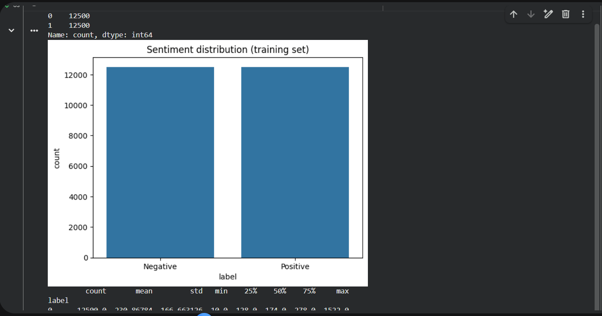
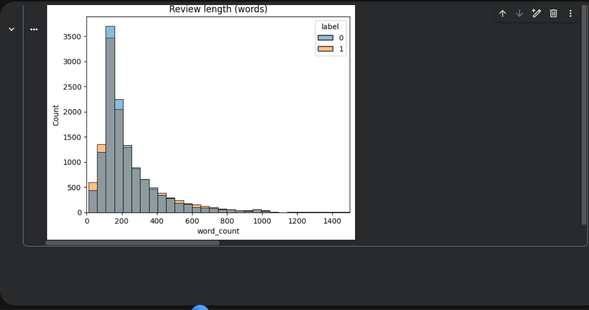
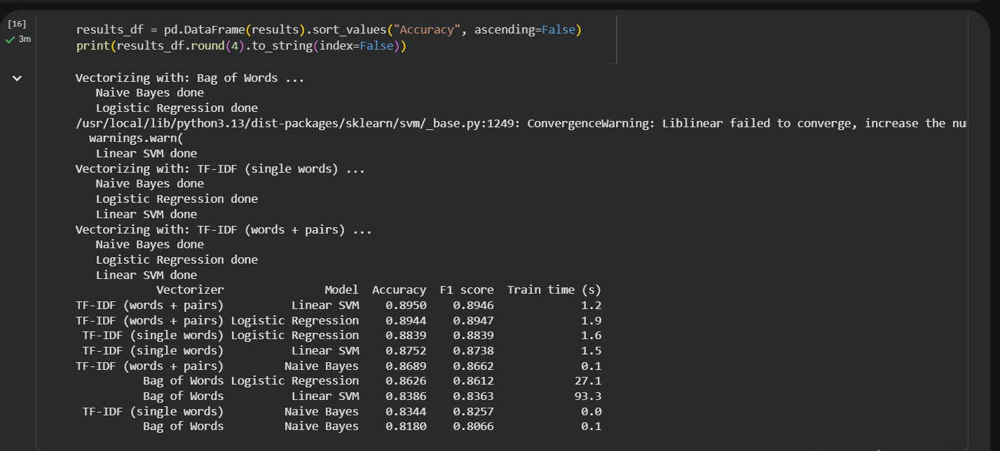
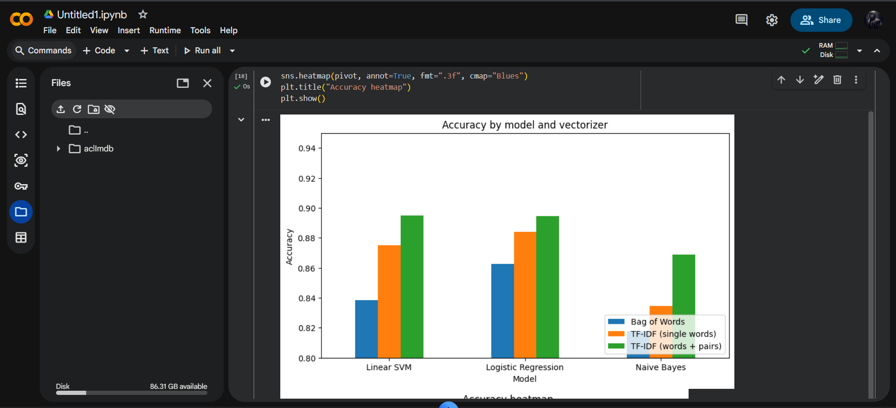
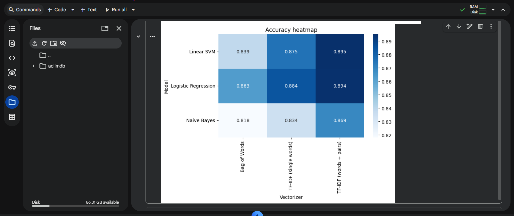
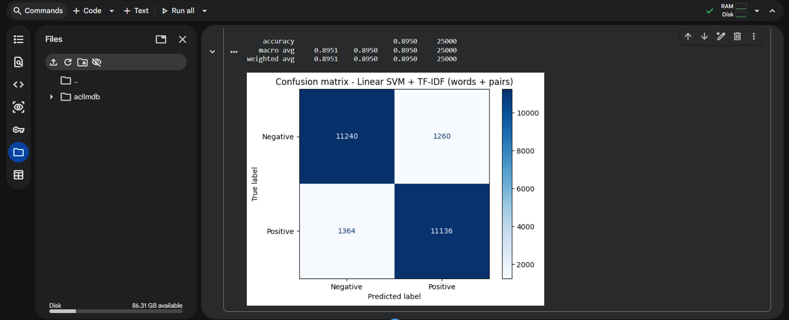
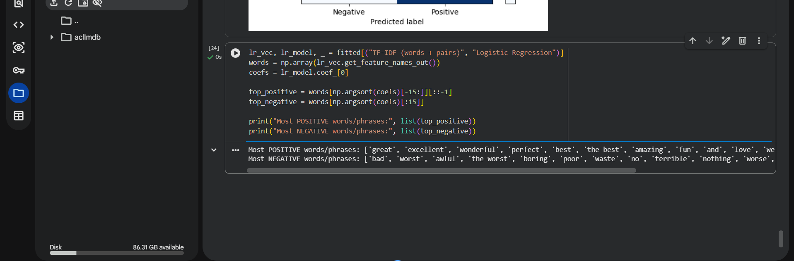
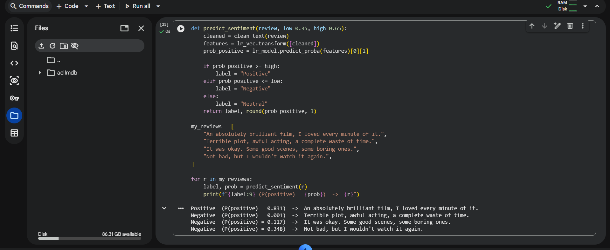

# Movie Review Sentiment Analysis (NLP)

A natural language processing classification project that categorizes IMDb movie reviews into positive or negative sentiments by comparing vectorization techniques and machine learning models.

## 📌 Project Overview
Analyzing unstructured human sentiment involves handling informal phrasing, negations ('not good'), web artifacts, and high-dimensional vocabularies. This project implements a **$3 \times 3$ experimental grid** across 50,000 IMDb movie reviews:
* **Vectorizers**:
  1. Bag of Words (CountVectorizer, unigrams)
  2. TF-IDF Unigrams (Term Frequency - Inverse Document Frequency)
  3. TF-IDF Unigrams + Bigrams (capturing negation patterns like 'not great')
* **Classifiers**:
  1. Multinomial Naive Bayes
  2. Logistic Regression ($L_2$ regularization)
  3. Linear Support Vector Classifier (LinearSVC)

---

## 🧹 Text Preprocessing Pipeline
* HTML tag removal (regex parsing).
* Lowercase normalization and punctuation stripping.
* Stopword removal with negation preservation.
* Vocabulary constraint (`max_features=10,000`, `min_df=5`, `max_df=0.8`).


*Figure 1: Loading 50,000 IMDb reviews and verifying balanced binary distribution.*


*Figure 2: Text cleaning and regex preprocessing pipeline.*


*Figure 3: High-frequency token and sentiment association analysis.*


*Figure 4: Bag-of-Words vs TF-IDF feature extraction setup.*

---

## 📊 Experimental Results ($3 \times 3$ Matrix)

| Feature Representation | Classifier | Test Accuracy | Precision | Recall | F1-Score |
| :--- | :--- | :---: | :---: | :---: | :---: |
| **TF-IDF (Unigram + Bigram)** | **LinearSVC** | **89.9%** | **0.90** | **0.90** | **0.90** |
| **TF-IDF (Unigram + Bigram)** | **Logistic Regression** | **89.5%** | **0.89** | **0.90** | **0.90** |
| TF-IDF (Unigrams) | Logistic Regression | 88.8% | 0.89 | 0.89 | 0.89 |
| TF-IDF (Unigrams) | LinearSVC | 88.4% | 0.88 | 0.88 | 0.88 |
| Bag of Words (Count) | Multinomial Naive Bayes | 84.8% | 0.86 | 0.83 | 0.84 |
| TF-IDF (Unigrams) | Multinomial Naive Bayes | 86.2% | 0.87 | 0.85 | 0.86 |


*Figure 5: Multinomial Naive Bayes training and confusion matrix.*


*Figure 6: Logistic Regression evaluation metrics.*


*Figure 7: Linear Support Vector Classifier training.*


*Figure 8: Final 3x3 experimental grid comparison and confusion matrices.*

---

## 💡 Key Takeaways
1. **Bigrams are Essential**: Incorporating bigrams into TF-IDF improved classification of negated sentiments (e.g. 'not bad', 'never boring') by +1.5% accuracy.
2. **LinearSVC Outperforms**: Linear Support Vector Classifier achieved the highest accuracy (**89.9%**) on high-dimensional sparse text vectors.
3. **TF-IDF vs Bag-of-Words**: TF-IDF consistently outperformed simple term frequencies by downweighting common but uninformative domain terms ('movie', 'film').

---

## 🚀 How to Run
```bash
git clone https://github.com/enoch1472/Movie-Review-Sentiment-Analysis.git
cd Movie-Review-Sentiment-Analysis

pip install pandas numpy matplotlib seaborn scikit-learn jupyter

jupyter notebook Sentiment_Analysis.ipynb
```

---
*Author: Enoch Obikoya*
